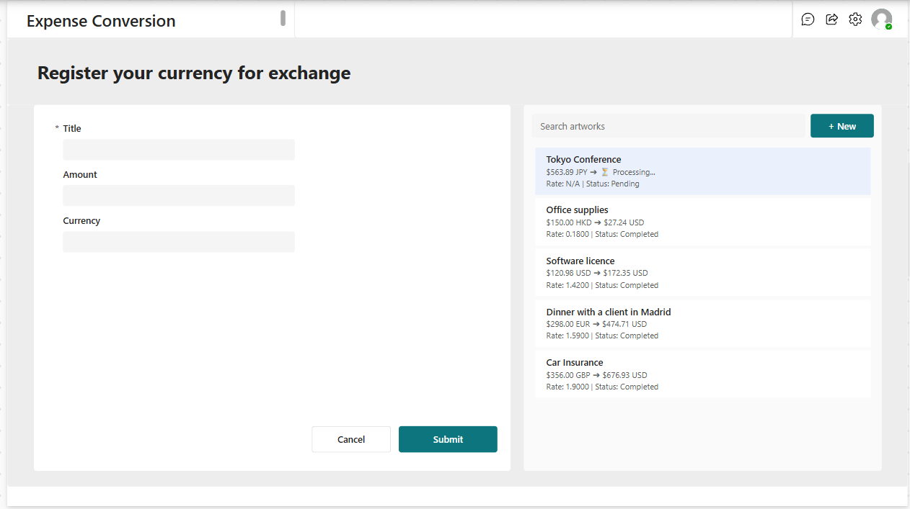
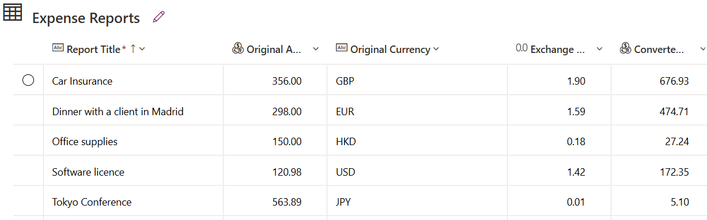
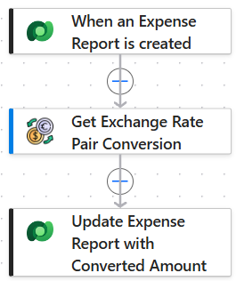

## Expense currency converter

### Overview
The Expense Conversion Hub enables users to record expenses in any foreign currency (e.g., CLP, EUR, GBP) and automatically converts them to AUD in real-time.

### Key Features
* **Two-panel Canvas UI:** a dedicated form for submitting new expenses and a gallery that updates the information in real time.
* **Server-side direct conversion (API):** uses the ExchangeRate API’s currency pair conversion endpoint to perform accurate calculations.

### Tech Stack
1. **Power Apps (user interface):** Form for submitting currency conversion information. List containing up-to-date data from the exchange rate records.
2. **Microsoft Dataverse (database):** Database of exchange rate records.
3. **Power Automate (event-driven trigger):** An automated workflow that sends requests to the API and returns the correct currency.
4. **API Integration:** Custom Connector linked to v6.exchangerate-api.com

---

## Exchange rate form and list of records (Power Apps)

### Key Features
* **Form:** Form for submitting exchange rate records..
* **List:** List showing exchange rates and their status.

## Exchange rate form and list of records (Power Apps)

### Key Features
* **List:** records of exchange rate enquiries.

## Exchange rate form and list of records (Power Apps)

### Key Features
* **Workflow:** API call workflow.

---

## Author
* **Portfolio Project:** automation-request-power-platform
* **Technology Focus:** Power Platform (Power Automate, Power Apps, Sharepoint, Power Bi)
* **Name:** Barbara Contreras

---
> [!NOTE]
> **Data Privacy & Security Disclaimer:**
> To comply with corporate privacy standards and data protection policies, all internal tenant URLs, proprietary schema names, and specific stakeholder email addresses have been masked, or parameterized across codebase scripts and documentation visuals.
